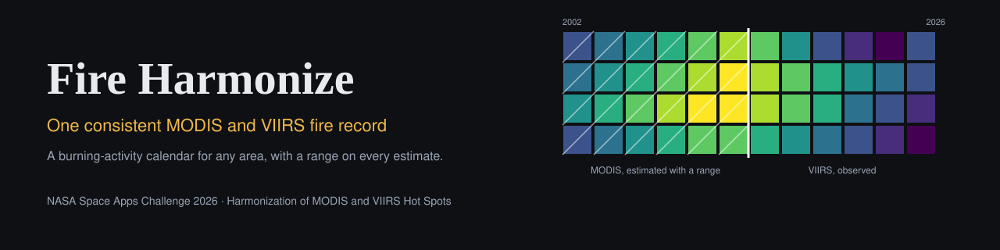
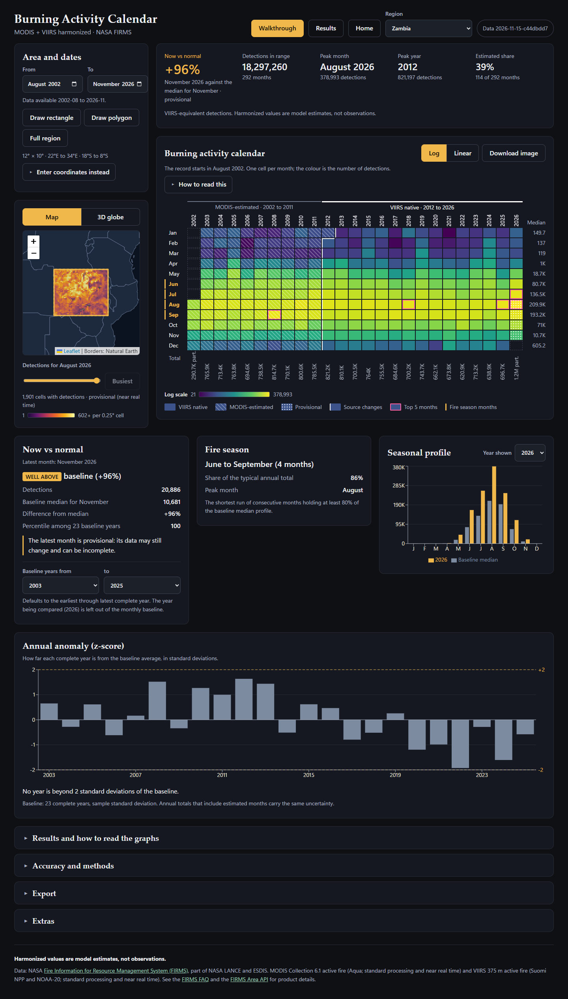

<p align="center">
  
</p>

<p align="center">
  
  
  
  
  
  
</p>

# Fire Harmonize

**A burning-activity calendar built on a single, consistent MODIS and VIIRS fire record.**

Entry for the 2026 NASA Space Apps Challenge, *Harmonization of MODIS and VIIRS Hot Spots*.



## Overview

Satellites have recorded active fires since 2000, but the record is split across two sensor families. MODIS (1 km pixels, from
2000) has the long history. VIIRS (375 m pixels, from 2012) sees smaller fires and therefore counts more of them. Adding the two
series together produces a false jump in 2012.

Fire Harmonize converts the MODIS record to a VIIRS-equivalent scale, attaches an uncertainty range to every estimated value,
and presents the result as a month-by-year calendar for any area the user chooses. It is a static web application: there is no
backend, and every number it shows comes from a reproducible Python pipeline.

**Intended users:** emergency responders, land managers and scientists who need to know whether a month is unusual for a place,
and how far each number can be trusted.

**Demo regions:** Western North America (`western_na`, California to southern British Columbia) and Zambia (`zambia`, savanna).
A region is one entry in `config/regions.json`; the app works for any area drawn inside a processed region.

## Features

- **Burning activity calendar**: years across, months down, 2002 to the present. Estimated months are hatched, provisional months
  are dotted, and the point where VIIRS observations begin is marked. Colour scales are colour-blind safe, and no meaning relies on
  colour alone.
- **Area and date selection**: draw a rectangle or polygon on the map, type coordinates, or use the full region.
- **Headline numbers**: peak month and year, estimated share, and *Now vs normal*, the latest month against the median of the same
  calendar month over the baseline years.
- **Fire season, seasonal profile and annual anomalies** against a baseline the user can change.
- **Map and 3D globe** of detections by month.
- **Compare areas tab**: two areas of the same region side by side: totals with ranges, fire seasons, latest month against normal,
  seasonal shape, annual anomalies, and whether the two areas tend to burn in the same years.
- **Results and method tab**: a plain-language summary, a guide to reading each graph, and how the numbers are made.
- **Accuracy and methods**: measured error by area size, model comparison and limitations, read from the pipeline's validation.
- **Shareable view**: a button copies a link that reopens the same region, area and dates.
- **Exports**: CSV (harmonized monthly counts and gridded cells), chart images, and a PDF report per region.
- **Accessibility**: keyboard-navigable calendar with text labels on every cell, minimum 14 px text, 44 px controls, an audible
  version of the calendar, and a guided walkthrough.

## Method

1. **Source.** NASA FIRMS standard-processing archive (MODIS Aqua, VIIRS Suomi NPP, VIIRS NOAA-20), using the yearly country
   files, the FIRMS area API for the current year, and near-real-time NOAA-20 for the latest months (marked *provisional*).
2. **Filters.** Only detections typed as presumed vegetation fire; MODIS Terra excluded; low-confidence detections dropped;
   static sources such as gas flares removed with a location mask built from standard-processing VIIRS data.
3. **Grid.** Detections are summed into 0.25 degree cells by calendar month.
4. **Harmonization.** MODIS counts from before VIIRS existed are converted to VIIRS-equivalent counts with a ratio fitted for
   each calendar month and each level of MODIS activity (how many MODIS detections the surrounding 1 degree block had that
   month) on the 2012 to 2021 overlap. Five candidate models are compared by leaving each year out in turn. The model used is
   the lowest-error one whose bias is within 15 percent. That rule was chosen after seeing first results, and the activity
   model was added after seeing Western North America's results, so its error is somewhat optimistic; the validation output
   records both.
5. **Intervals.** Each estimated number carries a range taken from the 10th to 90th percentile of actual over predicted counts in
   held-out years, set separately for areas of 1 to 2, 2 to 3 and 3 to 5 degrees and for the whole region. These are empirical
   ranges, not formal confidence intervals.
6. **Continuity.** NOAA-20 is checked against Suomi NPP over their overlap, and over the latest months, rather than assumed equal.

The harmonization is never exact. Every value carries a source flag: `viirs_native`, `modis_estimated` or `provisional`.

## Validation

Leave-one-year-out cross-validation on the 2012 to 2021 overlap. Median absolute percentage error of an estimated month, by area
size. Figures are read from `data/processed/validation.json` and shown in the app under *Accuracy and methods*; they change if
the pipeline is re-run.

| Area (longer side) | Western North America | Zambia |
|---|---|---|
| 1 to 2 degrees | 99% | 20% |
| 2 to 3 degrees | 58% | 18% |
| 3 to 5 degrees | 39% | 17% |
| Whole region | 9% | 10% |
| Bias across sample areas | -0.8% | 0.0% |

Accuracy is solid at region scale and weaker for small areas, especially where detections are few. Western North America has
far fewer detections than Zambia (only 10 percent of its sample area-months have over 1,000, against 52 percent in Zambia),
so its percentage errors stay above the 30 percent target for every area size except the whole region, and the app says so.
For small areas the percentage swings widely; weighted by total detections the error is 9 to 24 percent. Interval coverage on held-out
years is 76 to 81 percent against an 80 percent target.

## Limitations

- The MODIS-to-VIIRS relationship is fitted on 2012 to 2021 and assumed to hold for 2002 to 2011. This cannot be checked.
- Aqua's overpass time has drifted later since about 2021 to 2022, so MODIS is used only to estimate months before VIIRS.
- Counts are detections, not area burned, and one fire produces many detections.
- Suomi NPP stopped delivering new FIRMS data on 2 November 2026; later months come from NOAA-20. The two sensors differ slightly,
  so the handover may add a small step in the latest months. The pipeline flags this.
- Near-real-time months have no type field, so static sources are removed with a mask. On 84 months of NOAA-20 data treated as
  untyped, the mask removed 92 percent of static sources in Western NA and 82 percent in Zambia, and wrongly removed 0.30 and
  0.03 percent of real vegetation fires (`pipeline/05_validate_mask.py`).
- The August 2026 near-real-time month in Zambia is the largest on record. Cross-checks with Suomi NPP and MODIS support it
  (`docs/nrt-check-august-2026.md`).
- The time step is monthly: suited to patterns, not to single events.
- The PDF report covers a whole region, not a drawn area, because the site has no server to render one.

## Getting started

Requirements: Python 3.11, Node.js 20 or later. Commands are for Windows PowerShell.

```powershell
python -m venv .venv
.\.venv\Scripts\Activate.ps1
pip install -r requirements.txt
Copy-Item .env.example .env          # add your FIRMS map key: FIRMS_MAP_KEY=...
cd web; npm install; cd ..
```

A FIRMS map key is free: <https://firms.modaps.eosdis.nasa.gov/api/map_key/>. The key is read from `.env` and is never stored in
the repository.

### Run the web app

The processed data the app loads is committed in `web/public/data`, so the app runs without the pipeline.

```powershell
cd web
npm run dev          # http://localhost:5173
npm run build        # static site in web/dist
```

### Reproduce the data

Raw FIRMS data is large and not in the repository.

```powershell
python pipeline/01b_fetch_country.py --region zambia
python pipeline/01b_fetch_country.py --region western_na
python pipeline/01_fetch.py --region zambia --start 2026-01-01 --end 2026-07-31
python pipeline/01_fetch.py --nrt-tail
python pipeline/02_prepare.py
python pipeline/03_harmonize.py
python pipeline/05_validate_mask.py
python pipeline/04_export.py
node web/scripts/report_data.mjs
python pipeline/06_report_pdf.py
```

### Tests

```powershell
python -m unittest discover -s pipeline/tests -v
cd web; npm test
```

## Repository layout

```
config/regions.json     regions: name, bounding box, FIRMS country names
pipeline/               01 fetch, 02 prepare, 03 harmonize, 04 export, 05 mask validation, 06 PDF report
pipeline/checks/        near-real-time sanity check
pipeline/tests/         unit tests for the pipeline
data/processed/         harmonized cells and validation.json
web/                    Vite and React application (static, no backend)
web/public/data/        exported data the app loads
web/public/reports/     generated PDF reports
docs/                   submission text, demo script, screenshots
```

## Deployment

The site is static. On Netlify, the included `netlify.toml` builds `web/` and publishes `web/dist`. On other hosts, set the root
directory to `web`, the build command to `npm run build` and the output directory to `dist`.

## Data and credits

- **Fire data:** NASA FIRMS (Fire Information for Resource Management System), part of NASA LANCE and ESDIS. MODIS Collection 6.1
  and VIIRS 375 m active fire.
- **Borders:** Natural Earth, via the `world-atlas` package.
- **Opening-page imagery:** NASA Blue Marble and NASA SVS Deep Star Map
- **Libraries:** React, Vite, Leaflet, Recharts, d3-scale-chromatic, three.js, topojson-client, pandas, NumPy, ReportLab.

## Use of AI tools

An AI coding assistant was used during development, under the author's direction, for parts of the pipeline, the web app and the
tests. All figures in the app come from the pipeline and its validation, not from the assistant.

## License

No license has been chosen yet. All rights reserved by the author until one is added.
